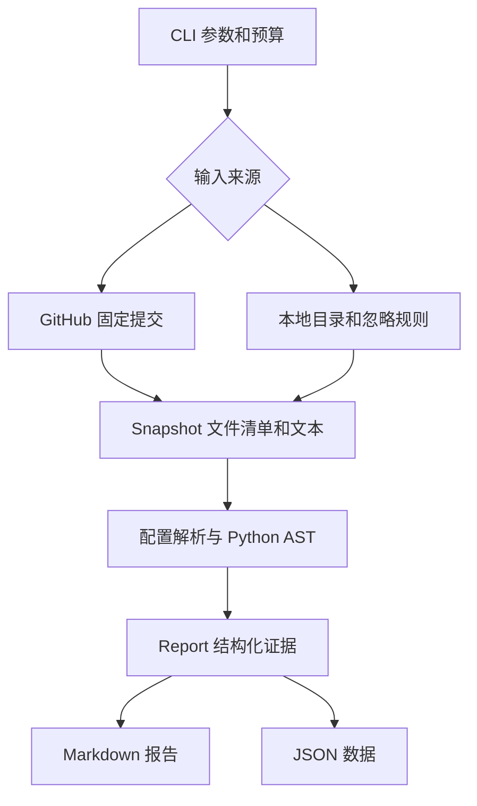

# 设计说明

## 为什么先做静态分析

项目的核心问题是：在不运行陌生仓库、不支付模型费用的前提下，快速找到值得阅读的文件，并知道每项结论来自哪里。RepoLens 将“智能”落实为读取优先级、结构化提取和证据链接，而非生成无法验证的架构介绍。

## 数据流

## 模块职责

| 模块 | 责任 | 关键设计 |
| --- | --- | --- |
| `cli.py` | 参数、来源选择、退出码、输出 | stdout 只输出报告；状态写 stderr；已有输出需 `--force` |
| `models.py` | 快照、证据、报告契约 | Pydantic 验证；JSON 包含 `schema_version` |
| `sources.py` | 安全边界和资源预算 | 本地不运行 Git；远端只 GET 固定 GitHub API |
| `analyzer.py` | 提取依赖、入口、符号和导入边 | 配置解析与 AST 不执行目标代码 |
| `render.py` | 用户可读报告 | 文本转义；源码链接固定提交；展示上限 |

## 关键决策

1. **提交一致性**：先解析 ref 得到 commit SHA 和 tree SHA，再按 tree 的 blob SHA 读取文件。避免 default branch 在读取过程中变化。
2. **按预算逐步读取**：先列文件，再选择配置、README、入口和 Python 源码。默认最多读取 35 个候选文件。大仓库报告明确为部分结果，不在限流后无限重试。
3. **事实与推断分开**：`project.scripts` 是配置声明；`__main__` 守卫是语法证据；CMake 正则和 `__main__.py` 文件名是线索。它们都不等于实际成功启动。
4. **可复用核心**：获取、分析、呈现分离。可用 `analyze(snapshot, limits)` 对离线数据做分析，也可以以后添加其他渲染器。
5. **输出保护**：先写同目录临时文件。默认通过硬链接原子创建目标，避免并发覆盖；显式 `--force` 时原子替换。目标文件系统需要支持硬链接（如 NTFS、ext4）；不支持时会返回文件操作错误，可改为 stdout 重定向。

## 远端缓存和请求预算

- Blob 以 GitHub 仓库名称、仓库 ID 和内容 SHA 隔离。按 Git 的 `blob <size>\0` 头和原始字节重算 SHA，并核对目录树中的大小，校验通过后才使用缓存或写入网络内容。
- SQLite 记录的 SHA-256 摘要绑定缓存键、ETag 和正文，用于检测损坏。写入和按访问顺序淘汰在同一事务中完成。缓存文件不可用时，在线读取继续使用原有预算。
- 仓库元数据和完整递归树仅缓存来自匿名公开仓库的有效 200 响应。只有相同 API 路径及查询参数的有效条目才能发起条件请求。304 复用本次请求对应的已校验正文；访问被拒、响应异常和断网走原有错误路径。未截断的缓存树仍受每次扫描的目录条目预算限制。
- 每次重新获取提交，按树 SHA 请求目录树。带 Token 的读取绕过磁盘缓存，避免保存认证后的响应或跨认证范围复用数据。条件请求也消耗应用的请求预算；GitHub 返回限流或剩余配额为零时，停止后续网络请求。缓存命中可继续按文件和字节预算读取。

## Python AST 的能力边界

`PythonVisitor` 使用作用域栈生成 `Class.method.inner` 等限定名；记录节点的起止行。AST 看到的是代码语法：即使 import 在函数、条件分支或 `TYPE_CHECKING` 中，也会被记录。

导入边只匹配清单内可唯一映射的模块名称：去掉 `.py`，识别根 `src/` 和包 `__init__.py`，计算相对 import 的包路径。冲突的模块名称不会猜测。`obj.method()` 仅记录调用表达式，不猜测 `obj` 的运行时类型。

## 错误策略

- 源头不可用：参数、元数据、权限错误，命令失败。
- 单文件坏数据：解码或解析失败，跳过并记录警告。
- 内容阶段预算耗尽、限流或断网：保留已获取的报告，显示未完成范围。
- GitHub 502/503/504 和连接类错误：最多尝试 3 次，短暂退避；429 和明确限流直接提示，不无限等待。
- 不把请求头、Token、代理密码或完整异常堆栈写入常规错误提示。

## 测试策略

使用 `httpx.MockTransport` 验证协议行为；临时目录验证读取范围和不执行目标代码；CLI 测试验证 UTF-8、带空格路径、stdout/stderr 分离及覆盖保护。真实仓库烟雾测试单独记录，不让日常测试依赖外网稳定性。

## 已知取舍

远端递归树若被 GitHub 截断，当前不递归补拉子树，防止请求数突然放大。默认读取有限文件、Markdown 展示有限条目，JSON 保留全部已提取数据。未来可增加独立的完整扫描模式和语言解析插件，但应保留预算及证据契约。
